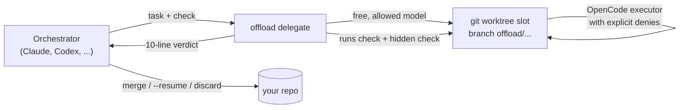

<div align="center">

# agent-offload

**Your expensive agent decides. Free models type. A check you trust says who was right.**

Let Claude, Codex or any agent that can run a shell command hand bulk coding work to free
models through [OpenCode](https://opencode.ai) - on a separate branch, in a separate
working copy, behind a check the executor cannot fake.

`Python 3.10+` · `no dependencies` · `MIT` · `any orchestrator` · `any OpenCode provider`

</div>

```text
$ offload delegate --scope kotlin --task-file due-dates.md
PASSED  model=openrouter/thinkingmachines/inkling:free  role=build  851s
branch: offload/kotlin-core-due-dates-1793342820-5cea11  (base 40b297f2a1c3)
files: kotlin/core/src/main/kotlin/todo/Task.kt, kotlin/core/src/main/kotlin/todo/ListOrder.kt, ...
diff: 6 files changed, 412 insertions(+), 18 deletions(-)
check [PASSED]: cd kotlin && .\gradlew.bat -q test installDist && app.bat conform ...
executor spent: 93 steps, 95971 in / 10172 out / 13167 reasoning tokens, 5805952 from cache, $0
merge: git merge offload/kotlin-core-due-dates-...   discard: git branch -D offload/...
```

An abridged verdict from the A/B run below. Your agent reads those lines, not 400 lines
of someone else's code.

## What you get

| | What it does | Measured |
|---|---|---|
| **Delegate** | Free model works on its own branch in its own git worktree; your tree is never touched | 15+ real delegations, Rust / Kotlin / egui / Compose |
| **Verify** | The kit runs your check itself, plus a hidden one the executor never saw | Free models' code passed 101/101 hidden checks |
| **Parallel** | Independent tasks run at once, each in a warm working copy | 2 delegations side by side, main tree clean throughout |
| **Free review** | A free model reviews a branch first; you read the findings | `--role review --on <branch>` |
| **Stay free** | Only models with a listed price of zero and tool use; paid ones are refused | 358 paid models filtered out after connecting OpenRouter |
| **Survive providers** | Quota stops skip the provider, stalls are killed, the next model is tried | Zen quota ran out mid-task; OpenRouter finished it |
| **Keep it private** | Per-project privacy policy; unknown terms are denied | `strict` by default when nobody is there to ask |

## Quick start

You do not need to learn the commands. Give this repository to your agent and say:

> Install agent-offload and run `offload init` in this project.

Or by hand:

```bash
pip install git+https://github.com/igorxmel/agent-offload
offload init --verify "pytest -q"        # how to tell a good result from a bad one
offload models --allowed                 # what the project policy lets through
offload delegate --task-file task.md     # hand it over, get a verdict
```

Needs [`opencode`](https://opencode.ai/docs) on `PATH`. Nothing else is installed into
your project: no dependencies, by design.

## How it works



1. **Pick a model** that is free, can call tools and fits the project's privacy policy.
   Prices and capabilities come from the [models.dev](https://models.dev) catalog OpenCode
   is built on, privacy terms from OpenCode's own page - fetched at run time, never
   hardcoded.
2. **Run it** in a working copy of its own, as an OpenCode agent whose limits are
   explicit denies: no leaving the folder, no `.env`, no `git push`, no `pip install`, no
   editing its own limits.
3. **Check it yourself.** The executor's report is shown but never trusted: the kit runs
   the check, then the held-out check, and reports what they actually printed.
4. **Hand back a verdict.** Merge it, `--resume` it with a numbered list of what is wrong,
   or let a free model review it first.

## Proof

**A/B on one real task** (due dates across a Rust core, a Kotlin core, an egui Windows
app and a Compose Android app; same start commit, same model, fresh sessions):

| | Orchestrator alone | Orchestrator + agent-offload |
|---|---|---|
| Orchestrator output tokens | 44.2k | **17.1k** (2.6x fewer) |
| Orchestrator cost, list-price weighted | 100% | **~80%** |
| Wall time | **13 min** | 96 min (6 delegations in a row) |
| Hidden checks passed | 101/101 | 101/101 |
| Executor | - | 505 steps, ~700k tokens, **$0** |

The saving is real but modest on a task this size, and it was paid for in time. That run
was sequential; parallel slots and free first review came out of it. The full numbers,
including what did not work, are in [AGENTS.md](AGENTS.md#measuring-the-saving).

**What free models built** in the todo-sync experiment, every piece behind hidden checks
the executor never saw: a merge core in Rust and in Kotlin, UDP discovery and TCP sync on
both, a Windows app and an Android app that sync over real Wi-Fi in 1-2 seconds.

## Guards, each from something that went wrong

| What happened | What the kit does now |
|---|---|
| A model "passed" by fitting code to the visible tests | `--holdout CMD`: a second check, never written to disk or the task |
| An executor committed a linker hack and stray objects outside its folder | `--scope PATH`: changes elsewhere are discarded and listed |
| An executor committed a 380 MB heap dump | files above `max_file_kb` (5 MB) are discarded |
| A provider stopped answering; 30 minutes lost | `stall_timeout`: silence for 10 min kills the run, next model |
| The free quota ran out for every model at once | quota messages mark the provider exhausted for an hour; status `quota` |
| Connecting OpenRouter listed 358 paid models as acceptable | only a listed price of zero passes; `offload allow groq/*` for free-tier keys |
| OpenCode worked in the caller's folder, not the project | the executor's `PWD` is always the project |
| An executor tried to edit its own limits | the work is discarded, exit 5 |

## Commands

```text
offload init                         set the kit up in a project
offload models [--allowed]           models, and whether the policy allows them
offload pick --role build -v         choose a model (basis: prefer | history | guess)
offload allow|deny <model|provider/*>
offload discover                     refresh models, prices, privacy terms
offload delegate --task-file F       hand a task over, get a verdict
    --scope PATH  --holdout CMD  --resume BRANCH  --model M  --verify CMD
    --role review|explore|plan  --on BRANCH
```

Every command takes `--json` (before the command name). Exit codes: `0` passed, `2` no
acceptable model, `3` check failed or nothing changed, `4` every attempt failed (status
`quota` when they all hit a quota), `5` the executor touched its own limits.

## Privacy and cost

Free models run on someone else's servers: **your code leaves your machine**, and some
providers train on prompts. `init` asks what kind of code this is:

| Preset | Allows |
|---|---|
| `strict` (default without a human) | no training, no retention of prompts |
| `private` | no training, retention up to 30 days |
| `open` | anything, including models that train on prompts |

The rule everywhere is **unknown is denied**: a model with no privacy data, no known price
or no known tool use is not used until you allow it by hand. A broken page parser closes
access; it never opens it.

## Works with

| Orchestrator | | Executor providers (through OpenCode) | |
|---|---|---|---|
| Claude Code | used daily, skill in `skills/offload` | OpenCode Zen free models | verified |
| Any agent that runs shell commands | by design | OpenRouter `:free` models | verified |
| Codex, Cursor, others | not tested yet | Google AI Studio | works, slow |
| | | Groq free tier | too small for an agent (7k tokens/min) |

## When not to use it

- **Small tasks.** Reading a weak model's result costs more than writing it yourself.
- **No machine check.** Without `verify` the kit refuses to delegate, on purpose.
- **When minutes matter.** Delegation trades the orchestrator's tokens for wall time.
- **Secret code on free tiers.** Check what the policy allows before you loosen it.

## Contributing

Rules for working on the kit, verified behaviour of OpenCode and every experiment's
lessons live in [AGENTS.md](AGENTS.md). Run `python -m pytest tests -q` first.

License: [MIT](LICENSE).
